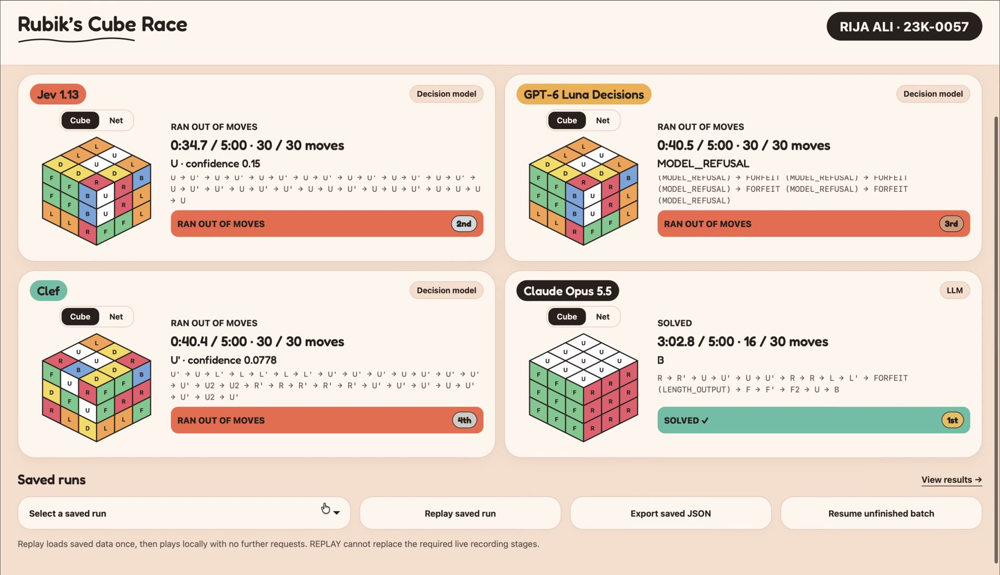
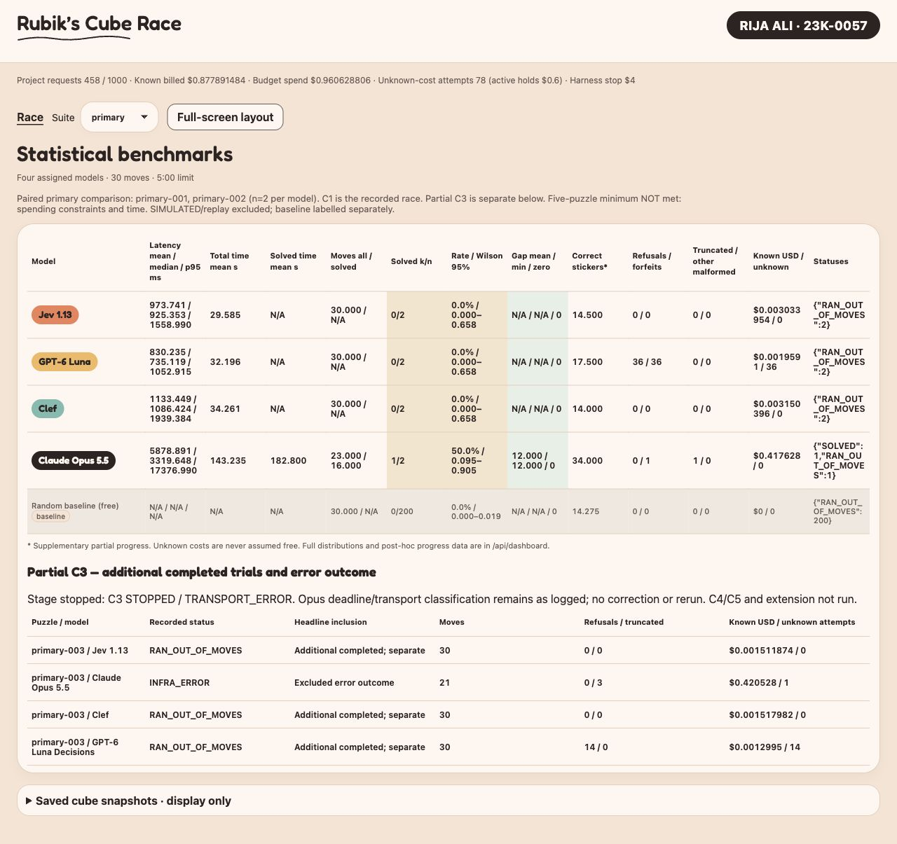

# Rubik’s Cube Race — AI Engineering Assignment 02

**RIJA ALI · 23K-0057**

A reproducible OpenRouter experiment comparing move latency and cube-solving outcomes across four assigned models on two paired primary puzzles, with warm-up and partial-stage results kept separate.

## DEMO VIDEO

**[Watch the recorded LIVE C1 race](demo/rubiks-cube-race-demo.mp4)** · [GitHub video link](https://github.com/Srijaali/ai-engineering/blob/main/demo/rubiks-cube-race-demo.mp4) · [Original supplied recording](https://drive.google.com/file/d/1n-CPs4JyyeCBS0e388Dxj3GwXwaDbulI/view?usp=share_link)

[](demo/rubiks-cube-race-demo.mp4)

**Duration: 4:32.795 (approximately 4:33); size: 13,143,797 bytes (13.14 MB / 12.54 MiB).** H.264 video, AAC silent audio, 1920×1104, 30 fps. The supplied source is 191,352,809 bytes, 3456×1988 HEVC with no audio track. The compressed copy adds a silent AAC track; it does not invent narration, change the action sequence or alter duration. The original file was not modified. Both files report exactly 272.795 seconds with ffprobe.

| Observed checkpoint | What is visible |
|---|---|
| **0:20** | In-progress LIVE C1 race; models choosing moves. |
| **3:15** | All models finished C1; Opus SOLVED at 16 actions, the decision models reached 30. |
| **4:00** | Statistics slide in the supplied recording. See the scope correction below. |

These timestamps were selected by frame inspection; the owner supplied the total video length, not the three checkpoint timestamps. **AUTHOR CHECK: confirm these selected checkpoints before submission.** Name and roll are in the fixed header; they were readable at 0:00, 0:20, 2:16.398, 3:15, 4:00 and 4:32. This is spot checking, not an every-frame visibility audit.

**Recording scope correction:** the original closing dashboard predates the final paired-scope decision and includes completed C3 decision-model trials in denominators (0/3). The final README/current dashboard use paired C1+C2 (0/2 and 1/2), with C3 separate. The recording’s historical slide has not been altered or represented as matching the corrected headline. **AUTHOR ACTION: decide whether to replace the closing slide/recording; a corrected dashboard image appears below.** C1’s in-progress/completion footage is a real LIVE run, not replay.

<!-- RESULTS:START -->
### Results at a glance — paired primary set

**Paired sample: 2 primary puzzles (primary-001, primary-002); one trial per model per puzzle.** C1 is the recorded race. C2 is included under the same frozen protocol. C3 is reported separately below. The recommended five-puzzle minimum was **NOT met**, due to spending constraints and time. No population-wide ranking is claimed.

| Model | Solved k/n | Wilson 95% | Mean move latency ms | Mean total s | Mean moves all / solved | Solved-primary gap mean |
|---|---|---|---|---|---|---|
| Jev 1.13 | 0/2 | 0.00%–65.76% | 973.741 | 29.585 | 30.000 / N/A | N/A |
| GPT-6 Luna Decisions | 0/2 | 0.00%–65.76% | 830.235 | 32.196 | 30.000 / N/A | N/A |
| Clef | 0/2 | 0.00%–65.76% | 1133.449 | 34.261 | 30.000 / N/A | N/A |
| Claude Opus 5.5 | 1/2 | 9.45%–90.55% | 5878.891 | 143.235 | 23.000 / 16.000 | 12.000 |
<!-- RESULTS:END -->

## 4. Assignment recap and research question

The assignment asks whether faster decision models are more useful than a slower frontier LLM when the latter may solve a cube using fewer moves. A deterministic 3×3 engine exposes the same current state and 18 actions to four hosted models through OpenRouter. The application records response latency, wall-clock time, move count and whether the cube is solved within the declared limits. Exact shortest distances make solution quality measurable on the small primary puzzles. The actual paired sample here is two primary puzzles, with one additional partial stage; it does not meet the five-puzzle minimum recommended in the assignment.

## 5. Setup and run

Tested interpreter: **Python 3.10.0** on macOS. Kociemba 1.2.1 includes a native extension; a compatible C toolchain may be required when no wheel is available. No frontend build or external font service is needed.

```bash
python3 -m venv .venv
source .venv/bin/activate
python -m pip install -r requirements.txt
cp .env.example .env
python scripts/build_bfs.py
python scripts/run_benchmark.py --build-baseline
python scripts/make_readme_results.py --check
python -m pytest backend/tests -q
python scripts/check_flow.py
python -m uvicorn backend.app.main:app --host 127.0.0.1 --port 8000 --workers 1
```

Open http://127.0.0.1:8000/ and http://127.0.0.1:8000/dashboard.html. Stop with Ctrl+C. Edit the new local `.env` with your own student identity before a recording. The template contains only placeholders; never copy a real key into README or frontend files. An empty/placeholder key suffices for viewing, replay and SIMULATED development; configure a real backend key only for a separately authorized paid run.

**Minimum-spend workflow:** install, rebuild the local BFS cache, run the offline tests, view the saved dashboard, and replay the existing real runs. These steps make zero inference requests. The race page defaults to **SIMULATED**, clearly labelled and excluded from LIVE statistics. SIMULATED uses free random mock agents. LIVE requires an explicit confirmation dialog showing calls, fixed settings, costs/cap and unknown charges; no GET, refresh, health check, export or replay triggers inference. Do not launch another smoke test or benchmark just to reproduce this report. A future new four-call smoke or five-puzzle benchmark requires separate owner approval; prior smoke and stage commands are not instructions to execute them now.

For free replay, select a saved LIVE run, wait for its data to load, then click **Replay saved run**. Playback is labelled REPLAY and makes no further requests; it does not replace live demonstration footage. Do not resume stopped C3 or rerun completed stages. CLI stage definitions preserve fixed membership and request caps, and the sequence command is one-shot. No stage is automatically restarted after interruption.

On a clean checkout the application seeds a new ignored local accounting database from the preserved public billing snapshot **without restoring reusable consent tokens**. Existing initialized ledgers are never reset or overwritten. Counters, reconciliation, block/stop states and missing costs survive this bootstrap. Back up the mutable local ledger before any future authorized work.

## 6. Experiment design and fixed methodology

### State, actions and equal information

`CubeEnv.reset(puzzle)` and `step(move)` mirror a classroom RL environment. Each observation contains exactly `facelets`, `facelet_order`, `net`, `recent_moves` (last six), `moves_used` and `moves_remaining`. The state is a 54-character **URFDLB** string, nine stickers per face in row-major Kociemba convention, plus the same cube as an unfolded net generated only by `engine.to_net()`. Net orientation is U above F, L–F–R–B across and D below F; each face retains its outside-view row-major orientation. Centres stay fixed, and the unique solved string is `UUUUUUUUURRRRRRRRRFFFFFFFFFDDDDDDDDDLLLLLLLLLBBBBBBBBB`.

The net was added identically for all four models after Luna refused string-only cube questions and a net-form diagnostic succeeded. These were small diagnostic samples, not proof of a causal fix. Shared accepted wording is frozen in [prompts.py](backend/app/prompts.py). Its exact question is **“Choose the single next move most likely to progress toward the solved cube.”** The complete shared instructions and 18 identical move descriptions are generated there and retained in the saved attempts. Prompts contain no scramble sequence, reference solution, BFS distance, puzzle metadata or other agent’s decisions. Apostrophe option keys remain legal. No inverse blocking, hinting, solver policy or action prefilter beyond the 18 actions is used.

Actions are `{U,D,L,R,F,B} × {clockwise 90°, counterclockwise 90°, 180°}`. This is the **half-turn metric (HTM)**: a half-turn counts as one move. The engine generates sticker permutations geometrically using positions and normals, with independent Kociemba round trips, move identities, commutation checks and exact-state count tests.

### Exact distances and fixed suites

Breadth-first search (BFS) starts at solved and searches all 18 moves to depth five. Verified new-state counts are:

| Distance | 0 | 1 | 2 | 3 | 4 | 5 | Total |
|---|---:|---:|---:|---:|---:|---:|---:|
| States | 1 | 18 | 243 | 3,240 | 43,239 | 574,908 | **621,649** |

The recorded build took 5.338 s; peak process RSS was 190,840,832 bytes, and the gzip cache was 9,921,966 bytes ([build evidence](docs/submission/original-bfs-build.json)). The cache is ignored and rebuilt locally. Distances outside the table are **unknown, at least 6**, never inferred as optimal. Independent meet-in-the-middle searches, without the cache/Kociemba, verified each warm-up/primary optimum.

Master seed **20261024** fixes three warm-up puzzles of length 3–4, ten primary puzzles (five length 4, five length 5), and five extension puzzles of length 15–20. Scrambles never repeat a face consecutively, and opposite neighbours obey U before D, L before R, F before B. Solved/duplicate states are rejected across suites. Small puzzles are accepted only when exact distance equals scramble length. Extension `exact_optimal` is null; Kociemba lengths are labelled `reference_upper_bound_not_optimal`, verified by applying them with our engine. Generation is byte-deterministic and contains no timestamps. **Generated suites are not evidence that they were run:** only C1/C2 are paired LIVE primary results; C3 is partial; C4/C5 and extension were not run.

### API and execution settings

Exact IDs and observed resolved strings/providers are in the generated results below. Jev is pinned to `typesafe/jev-1.13`; the other assigned IDs are `openai/gpt-6-luna-decisions`, `cloudflare/clef`, and `anthropic/claude-opus-5.5`. All use raw httpx for transparent timing. The three decision models use `/api/alpha/decisions`, one choice question named `next_move`; choice, confidence and all probabilities are retained when returned. Opus uses `/api/v1/chat/completions`, strict JSON schema `{move: enum of 18}`, `provider.require_parameters=true`, mandatory reasoning enabled, and no temperature parameter. No model was substituted. OpenRouter’s chat token/cost usage is returned in the observed responses; no additional paid calls retrieve billing.

| Fixed setting | Value |
|---|---|
| `CLAUDE_REASONING_EFFORT` | `low` |
| `CLAUDE_MAX_TOKENS` | **1024**, fixed across C1–C3; includes reasoning and answer allowance |
| `RUN_BUDGET_S` | **300 s**, first send to trial end |
| `MAX_MOVES` | **30** action slots, including forfeits |
| `REQUEST_TIMEOUT_S` | 120 s, also bounded by remaining run time |
| `MAX_TRANSPORT_RETRIES` | 1 for eligible transport/429/5xx faults, excluding refusals/permanent errors |
| `MAX_MALFORMED_RETRIES` | 0 |
| `MAX_REQUESTS` | 1000 lifetime attempts; never reset |
| `MAX_SPEND_USD` | **$4.00** hard harness cap; owner’s whole-project ceiling $5 |
| C2–C5 additional sequence stop | $2.50 reconciled basis plus newer known costs |
| Concurrency | One in-flight request per model; four models concurrent; puzzles/stages sequential |

All run snapshots retain these settings. The 1024 ceiling is the owner’s tentative choice pending a planned calibration that was **not executed**; it was nevertheless kept fixed for these trials. No per-trial adaptation was performed. `finish_reason=length` is invalid and counted separately as a truncated response. Strict string equality validates moves: no trimming, correction or fuzzy matching. Malformed/refused/truncated output forfeits one action, leaves the cube unchanged and is logged. Refusals are experimental outcomes, not permanent route failures. Under the later owner-approved protocol, models continue through forfeits until 30 actions/300 s; the original brief’s three-consecutive-forfeit early stop was not used. Permanent API failures and infrastructure faults have safety stops; C3 exposed the deadline classification bug documented below.

Timing uses `time.perf_counter()`. Attempt latency is send through parsed response body; per-move headline latency is the successful attempt only. Decision latency includes retries/backoff. Total trial time starts at the first request and ends at the run outcome; the sum of model latencies is separately logged. Mean, median and nearest-rank p95 are reported. No network-floor/RTT measurement was completed; do not interpret API latency as model compute time or claim a measured Karachi RTT. No sequential-concurrency latency rerun was performed.

Per-race display ranking follows the owner’s rule: solved trials by moves then time, unsolved by final correct stickers descending then time. These rank badges describe that race only and are not a general model ranking. Correct stickers are supplementary progress, not success percentage. The free seeded Random baseline uses 100 runs per evaluated puzzle; no hybrid or live Kociemba baseline was evaluated.

<!-- RESULTS:START -->
### 7. Full results — generated from saved evidence

Source: each `data/results/LIVE/<run_id>/records.jsonl` run record, matched to `run.json`; billing: `data/evidence/ledger.json`. These files are preserved for the owner to commit; no claim is made that uncommitted files already exist in Git history. SIMULATED runs and replay are excluded. Baselines have separate labelled rows.

Paired set: **primary-001, primary-002**, n=2 per model. A paired puzzle requires all four eligible terminal outcomes under identical saved settings. SOLVED, RAN_OUT_OF_MOVES, OUT_OF_TIME and ERROR_MODEL are eligible experimental outcomes; INFRA_ERROR and NOT_RUN are not eligible success denominators. C3's INFRA_ERROR is a saved terminal error, not a completed evaluation outcome.

#### Paired live trials

| Stage / puzzle | Model | Status | Moves | Total s | Latency mean / median / p95 ms | Gap | Refusals | Forfeits | Truncated | Known USD | Unknown attempts |
|---|---|---|---|---|---|---|---|---|---|---|---|
| [C1 / primary-001](data/results/LIVE/34f2e9b191ed6e951910f281b73b6c6b/records.jsonl) | Jev 1.13 | RAN_OUT_OF_MOVES | 30 | 34.708 | 1142.209 / 990.210 / 1863.958 | N/A | 0 | 0 | 0 | $0.001518384 | 0 |
| [C1 / primary-001](data/results/LIVE/34f2e9b191ed6e951910f281b73b6c6b/records.jsonl) | GPT-6 Luna Decisions | RAN_OUT_OF_MOVES | 30 | 40.471 | 1293.543 / 1034.071 / 2098.044 | N/A | 26 | 26 | 0 | $0.0003230 | 26 |
| [C1 / primary-001](data/results/LIVE/34f2e9b191ed6e951910f281b73b6c6b/records.jsonl) | Clef | RAN_OUT_OF_MOVES | 30 | 40.377 | 1338.816 / 1204.696 / 2537.761 | N/A | 0 | 0 | 0 | $0.001524528 | 0 |
| [C1 / primary-001](data/results/LIVE/34f2e9b191ed6e951910f281b73b6c6b/records.jsonl) | Claude Opus 5.5 | SOLVED | 16 | 182.800 | 10749.381 / 11848.353 / 20046.207 | 12 | 0 | 1 | 1 | $0.231488 | 0 |
| [C2 / primary-002](data/results/LIVE/f83d57c4ef71bcf498a3155c44547615/records.jsonl) | Jev 1.13 | RAN_OUT_OF_MOVES | 30 | 24.461 | 805.273 / 716.647 / 1263.211 | N/A | 0 | 0 | 0 | $0.001515570 | 0 |
| [C2 / primary-002](data/results/LIVE/f83d57c4ef71bcf498a3155c44547615/records.jsonl) | GPT-6 Luna Decisions | RAN_OUT_OF_MOVES | 30 | 23.921 | 737.574 / 731.178 / 782.700 | N/A | 10 | 10 | 0 | $0.0016361 | 10 |
| [C2 / primary-002](data/results/LIVE/f83d57c4ef71bcf498a3155c44547615/records.jsonl) | Clef | RAN_OUT_OF_MOVES | 30 | 28.146 | 928.083 / 854.159 / 1331.807 | N/A | 0 | 0 | 0 | $0.001625868 | 0 |
| [C2 / primary-002](data/results/LIVE/f83d57c4ef71bcf498a3155c44547615/records.jsonl) | Claude Opus 5.5 | RAN_OUT_OF_MOVES | 30 | 103.670 | 3443.646 / 3059.922 / 5734.322 | N/A | 0 | 0 | 0 | $0.186140 | 0 |

Across all saved LIVE trials: 0 retries, 0 other malformed outputs, 4 truncated responses and 65 refusals.

Latency is successful-attempt send-to-parsed-body time; invalid/refused/truncated attempts are excluded from this headline latency but remain in costs, total time and attempt logs. p95 is nearest rank. Moves include forfeits; C1 Opus used 16 actions including one forfeit. Gap is actions minus exact shortest distance and is defined only for solved primary trials. All paired puzzles have exact optimum 4.

#### Paired aggregates

| Model | Solved k/n | Wilson 95% | Latency mean / median / p95 ms | Total mean all / solved s | Moves mean all / solved | Move distribution | Gap mean / min / zero count / histogram | Final correct stickers mean | Refusals / forfeits / truncated |
|---|---|---|---|---|---|---|---|---|---|
| Jev 1.13 | 0/2 | 0.00%–65.76% | 973.741 / 925.353 / 1558.990 | 29.585 / N/A | 30.000 / N/A | {"30": 2} | N/A / N/A / 0 / {} | 14.500 | 0 / 0 / 0 |
| GPT-6 Luna Decisions | 0/2 | 0.00%–65.76% | 830.235 / 735.119 / 1052.915 | 32.196 / N/A | 30.000 / N/A | {"30": 2} | N/A / N/A / 0 / {} | 17.500 | 36 / 36 / 0 |
| Clef | 0/2 | 0.00%–65.76% | 1133.449 / 1086.424 / 1939.384 | 34.261 / N/A | 30.000 / N/A | {"30": 2} | N/A / N/A / 0 / {} | 14.000 | 0 / 0 / 0 |
| Claude Opus 5.5 | 1/2 | 9.45%–90.55% | 5878.891 / 3319.648 / 17376.990 | 143.235 / 182.800 | 23.000 / 16.000 | {"16": 1, "30": 1} | 12.000 / 12.000 / 0 / {"12": 1} | 34.000 | 0 / 1 / 1 |

#### Partial C3 stage — additional completed trials and error outcome

C2 and C3 were launched headlessly, sequentially, by `scripts/run_primary_sequence.py --execute --confirm-sequence primary-C2-C5-owner-20261025`, under the owner’s explicit C2–C5 authorization recorded in D-145. Each puzzle’s four models ran concurrently. C3 stopped on saved `TRANSPORT_ERROR`; Opus is `INFRA_ERROR` at approximately 300 s. The adapter combines deadline timeout with transport errors, and the runner checks fatal stage errors before deadline expiry. This likely misclassified the run deadline; it has **not been silently corrected**. No 402 or $2.50 crossing occurred. See [D-146](decisions.md), [execution log](docs/verification/c2-c5/execution.log), and the [saved C3 stage report](data/results/LIVE/912193241d4b3efe90f950d3e2e13df6/stage-report.json).

**Additional completed C3 trials, excluded from the paired headline:**

| Stage / puzzle | Model | Status | Moves | Total s | Latency mean / median / p95 ms | Gap | Refusals | Forfeits | Truncated | Known USD | Unknown attempts |
|---|---|---|---|---|---|---|---|---|---|---|---|
| [C3 / primary-003](data/results/LIVE/912193241d4b3efe90f950d3e2e13df6/records.jsonl) | Jev 1.13 | RAN_OUT_OF_MOVES | 30 | 22.971 | 753.530 / 694.162 / 1149.575 | N/A | 0 | 0 | 0 | $0.001511874 | 0 |
| [C3 / primary-003](data/results/LIVE/912193241d4b3efe90f950d3e2e13df6/records.jsonl) | GPT-6 Luna Decisions | RAN_OUT_OF_MOVES | 30 | 25.093 | 868.560 / 776.363 / 1365.983 | N/A | 14 | 14 | 0 | $0.0012995 | 14 |
| [C3 / primary-003](data/results/LIVE/912193241d4b3efe90f950d3e2e13df6/records.jsonl) | Clef | RAN_OUT_OF_MOVES | 30 | 27.015 | 888.324 / 848.730 / 1169.871 | N/A | 0 | 0 | 0 | $0.001517982 | 0 |

**C3 error/non-completed evaluation outcome, excluded from denominators:**

| Stage / puzzle | Model | Status | Moves | Total s | Latency mean / median / p95 ms | Gap | Refusals | Forfeits | Truncated | Known USD | Unknown attempts |
|---|---|---|---|---|---|---|---|---|---|---|---|
| [C3 / primary-003](data/results/LIVE/912193241d4b3efe90f950d3e2e13df6/records.jsonl) | Claude Opus 5.5 | INFRA_ERROR | 21 | 300.015 | 13181.690 / 14408.527 / 17985.738 | N/A | 0 | 3 | 3 | $0.420528 | 1 |

| Model | Eligible primary outcomes retained overall | Paired headline n | Additional completed C3 | Excluded C3 error |
|---|---|---|---|---|
| Jev 1.13 | 3 | 2 | 1 | 0 |
| GPT-6 Luna Decisions | 3 | 2 | 1 | 0 |
| Clef | 3 | 2 | 1 | 0 |
| Claude Opus 5.5 | 2 | 2 | 0 | 1 |

**C4, C5 and the extension suite: NOT RUN.** Other generated primary/warm-up puzzles were not evaluated live. Trials are not fabricated for unstarted stages.

#### Warm-up W — separate adapter verification

| Stage / puzzle | Model | Status | Moves | Total s | Latency mean / median / p95 ms | Gap | Refusals | Forfeits | Truncated | Known USD | Unknown attempts |
|---|---|---|---|---|---|---|---|---|---|---|---|
| [W / warmup-001](data/results/LIVE/b36abd523b1f492241fbf6879006d22d/records.jsonl) | Jev 1.13 | RAN_OUT_OF_MOVES | 30 | 29.469 | 972.226 / 916.562 / 1077.454 | N/A | 0 | 0 | 0 | $0.001518972 | 0 |
| [W / warmup-001](data/results/LIVE/b36abd523b1f492241fbf6879006d22d/records.jsonl) | GPT-6 Luna Decisions | RAN_OUT_OF_MOVES | 30 | 31.284 | 1074.658 / 982.199 / 2147.467 | N/A | 15 | 15 | 0 | $0.0012220 | 15 |
| [W / warmup-001](data/results/LIVE/b36abd523b1f492241fbf6879006d22d/records.jsonl) | Clef | RAN_OUT_OF_MOVES | 30 | 36.716 | 1206.014 / 1171.490 / 1531.792 | N/A | 0 | 0 | 0 | $0.001626582 | 0 |

Only Jev, Luna and Clef were authorized in W. Opus was NOT RUN in warm-up and has no fabricated trial/denominator. Warm-up is excluded from primary comparisons.

#### Random baseline — free, separate from model results

| Policy / scope | Runs per puzzle | Solved k/n | Wilson 95% | Moves mean | Correct stickers mean | Cost |
|---|---|---|---|---|---|---|
| Random baseline; same paired puzzles | 100 | 0/200 | 0.00%–1.88% | 30.000 | 14.275 | $0; no inference |

Seed 20261024; 100 independent random-policy runs per paired puzzle. Recomputed offline using the same engine. Baseline latency is N/A and is not mixed into the model sample size.

#### Per-move progress — post-hoc exact-distance scoring

| Model | Known-distance applied moves | Distance-reducing moves / known | On-optimal-path rate | Unknown-distance applied moves | Immediate inverses / pairs | Mean probability entropy nats |
|---|---|---|---|---|---|---|
| Jev 1.13 | 60 | 25/60 | 0.417 | 0 | 44/58 | 2.652 |
| GPT-6 Luna Decisions | 56 | 5/56 | 0.089 | 4 | 3/22 | 2.452 |
| Clef | 35 | 12/35 | 0.343 | 25 | 19/58 | 2.789 |
| Claude Opus 5.5 | 44 | 19/44 | 0.432 | 2 | 21/43 | N/A |

Only applied moves with both endpoints in the depth-five table enter the exact progress denominator; leaving the table is unknown (distance at least 6), not evidence of improvement. Forfeited unchanged-state actions follow the logged applied flag. Immediate inverse rates use consecutive valid applied moves, excluding forfeits. BFS was never available to live decisions.

#### Confidence calibration — descriptive only

| Model | Known-progress choices with confidence | Mean confidence when distance reduced | Mean confidence otherwise |
|---|---|---|---|
| Jev 1.13 | 60 | 0.126 | 0.113 |
| GPT-6 Luna Decisions | 20 | 0.274 | 0.231 |
| Clef | 35 | 0.089 | 0.054 |
| Claude Opus 5.5 | 0 | N/A | N/A |

#### Cost and request reconciliation — all stages retained

| Stage | Suite | Status | Requests | Known USD | Unknown-cost attempts |
|---|---|---|---|---|---|
| W | warmup | COMPLETED | 90 | $0.004367554 | 15 |
| C1 | primary | COMPLETED | 106 | $0.234853912 | 26 |
| C2 | primary | COMPLETED | 120 | $0.190917538 | 10 |
| C3 | primary | STOPPED | 112 | $0.424857356 | 15 |
| diagnostic | route/adapter probes | Not benchmark trials | 26 | $0.000729536 | 12 |
| phase3_smoke | route/adapter probes | Not benchmark trials | 4 | $0.022165588 | 0 |
| LEDGER TOTAL | All stages/accounts | Known subtotal only | 458 | $0.877891484 | 78 |

The stage request sum includes diagnostic and adapter probes and equals the ledger total. C4/C5/extension made zero requests. Phase 0 and adapter-probe timings never enter benchmark statistics.

| Model | Lifetime requests | Lifetime known USD | Unknown-cost attempts |
|---|---|---|---|
| Jev 1.13 | 125 | $0.006305838 | 0 |
| GPT-6 Luna Decisions | 134 | $0.0049334 | 72 |
| Clef | 125 | $0.006504246 | 0 |
| Claude Opus 5.5 | 74 | $0.860148 | 6 |

Owner-reported OpenRouter cumulative spend at the reconciliation checkpoint: **$0.11**, approximately 90K tokens (actual dashboard as-of time/view/date range unspecified). At attempt 120, known costs were $0.027262678; the unexplained difference **$0.082737322** remains unallocated. The checkpoint covers the original 27 unknown costs for budget accounting, not an invented per-model allocation. Adding subsequent known charges gives a **$0.960628806 reconciled spending basis**, plus 51 post-checkpoint unknown charges. This is not a final invoice. Missing charges are never zero. See [reconciliation note](results/RECONCILIATION-2026-10-25.md).

Current active holds: **$0.60** (50 classified Luna refusals × $0.01 and one unpriced Opus timeout × $0.10). These are owner-approved estimates, not billed costs. The $0.01 estimate was justified using the earlier gap/27 average, not a proven individual upper bound. Headroom after holds under the unchanged $4 cap: **$2.439371194**. The whole-project owner ceiling remains $5; the harness cap remains $4 and C2–C5 additionally had a $2.50 known/reconciled-spend stop.

#### Observed routes and paired token accounting

| Assigned model ID | API surface | Observed resolved strings | Observed providers | Paired input tokens reported / unknown attempts | Paired output tokens reported / unknown attempts | Paired reasoning tokens reported / unknown attempts |
|---|---|---|---|---|---|---|
| typesafe/jev-1.13 | POST /api/alpha/decisions | typesafe/jev-1.13-20260917 | TypeSafe | 72237 / 0 | 9387 / 0 | 0 / 60 |
| openai/gpt-6-luna-decisions | POST /api/alpha/decisions | openai/gpt-6-luna-decisions-20261006 | OpenAI | 19591 / 36 | 0 / 36 | 0 / 60 |
| cloudflare/clef | POST /api/alpha/decisions | cloudflare/clef | Cloudflare, DeepInfra, PrimeIntellect | 62657 / 0 | 0 / 0 | 0 / 60 |
| anthropic/claude-opus-5.5 | POST /api/v1/chat/completions | anthropic/claude-opus-5.5 | Claude Platform on AWS | 67852 / 0 | 7311 / 0 | 6841 / 0 |

Reported token sums cover only attempts with that field; unknown counts are shown separately. Opus output tokens include reasoning tokens where reported; do not add reasoning tokens again. No billing-only paid requests were made.




<!-- RESULTS:END -->

## 8. Answers to the five assignment questions

1. **Which model is fastest at making decisions?** In the paired table, Luna has the lowest mean successful-attempt latency: **830.235 ms**, versus Jev **973.741 ms**, Clef **1133.449 ms** and Opus **5878.891 ms**. However, Luna contributed only **24 valid-response latency samples** and had **36 refusals in 60 actions**. This is a conditional successful-response comparison, not proof that Luna reliably makes useful decisions fastest.
2. **Which model achieved the highest solve rate?** Opus solved **1/2** paired puzzles (Wilson 95% **9.45%–90.55%**); each decision model solved **0/2** (Wilson **0%–65.76%**). This describes these two puzzles only. The wide intervals, single attempt per puzzle and refusals prevent a general solve-rate ranking.
3. **Which model found the shortest solutions, and how close were they to optimum?** The only paired solution was Opus on C1: **16 action slots**, including **one truncated-response forfeit**, against exact optimum **4**, giving the declared action-based gap **12**. It executed 15 valid turns; this distinction is retained rather than silently changing the gap definition. C2 was unsolved by every model. Unsolved gaps are **N/A**, not zero; there is no set of multiple successful models from which to claim a general shortest-solution winner.
4. **Did the fastest model also achieve the best solution quality?** In this paired sample, Luna’s **830.235 ms** mean valid-response latency coincided with **0/2** solved and **36 refusals**; slower Opus at **5878.891 ms** solved **1/2**. These observations show the latency and solve outcomes differed here, but n=2 does not establish a general causal trade-off.
5. **Would you use a decision model, a frontier LLM, or a hybrid in practice?** A tentative choice for this specific solving task would be to investigate Opus further: it supplied the sample’s only solution, at **182.800 s** and **$0.231488** known C1 cost, while the decision models solved **0/2**. It also failed C2 and had **one paired truncation**. A hybrid is only a proposal: **zero hybrid trials** were run, so no hybrid quality, latency or savings claim is supported. A real deployment decision needs the unmet five-puzzle minimum, repeated trials and resolved billing/error limits before adoption.

## 9. Limitations, assumptions and deviations

- **Small paired sample:** two puzzles, one trial per model/puzzle. The assignment recommends at least five primary puzzles/20 trials; this was **NOT met because of spending constraints and time**. C2 was retained under the identical frozen protocol. C3’s three completed decision-model trials remain separately listed; Opus C3 is an excluded infrastructure-error outcome. C4/C5 and extension were not run.
- **Assignment text versus sample figures:** the PDF’s text specifies 30 moves and the four assigned model IDs. Its sample images show a 20-move loss, GPT-6 Sol/Laya labels, and OUT OF TIME at 5:00. We follow the text’s 30 moves and exact assigned IDs; the owner pre-declared **300 s** based on the 5:00 sample. The figures are illustrative, not a replacement model list or measured results.
- **Representation:** the net was added to the facelet string for every model after small Luna diagnostics. This is an explicitly accepted deviation from a string-only observation, with no claim of causation or universal refusal resolution. The frozen prompt was not shortened to save input tokens.
- **Fixed Opus settings:** low reasoning/1024 was owner-selected and held fixed. One C1 and three C3 responses were truncated. The larger-output calibration was blocked before any paid request. These settings were not optimized using this benchmark’s outcomes.
- **Refusals and denominators:** paired Luna had 36 refusals, plus 14 in additional C3 and 15 in warm-up. Valid-response latency therefore has a different sample size from action count. Confidence/probabilities, where present, are model outputs rather than independent correctness guarantees.
- **C3 stopping bug:** an in-flight Opus request reached the 300 s deadline and was logged TRANSPORT_ERROR, leading to INFRA_ERROR and a conservative stage-wide stop. This was neither a 402 nor a $2.50 breach. Actual exception subtype was not stored; the deadline diagnosis is supported by code and timing. It was not silently fixed, relabelled or rerun.
- **Network and concurrency:** requests travel from the user’s Karachi context to remote endpoints, but no measured network-floor probe or verified host-location/RTT value is available. All-four concurrency and remote routing/load can affect latency; the planned sequential rerun was not done. No pure inference-time conclusion is warranted.
- **Billing:** the shared key belongs to a friend’s billed account. There were several key/account changes. Unknown costs remain unknown; the $0.11 checkpoint is owner-reported with unspecified dashboard scope/time. The $0.082737322 gap is unallocated, and earlier missing requests cannot be ruled out. Hold estimates and key allowances are not account-balance proof or invoices. The hard harness cap is $4; no limit was raised for this report.
- **Analysis scope:** the paired headline includes all eligible complete four-model outcomes on C1/C2, without excluding C2 selectively. Additional completed C3 trials and its error are visible separately. Free random-policy simulations and replay never enter LIVE denominators. Generated extension references are upper bounds, not proven optima.
- **Recording:** C1’s live stages are preserved, but the recorded closing statistics precede the final paired-scope correction. The current dashboard/README are the corrected report; the historical video slide must not be mistaken for the paired headline.

## 10. Repository map

| Path | Purpose |
|---|---|
| [backend/app](backend/app) | Engine, fixed prompts, adapters, consent/budget guard, runner, paired analysis and FastAPI |
| [backend/tests](backend/tests) | Offline engine, API, budget, scope and reproducibility tests |
| [frontend](frontend) | Local race/dashboard, Cube/Net display and free replay |
| [data/puzzles](data/puzzles) | Final deterministic warm-up, primary and extension suites |
| [data/results/LIVE](data/results/LIVE) | Original real move/run/event logs and stage snapshots |
| [data/evidence/ledger.json](data/evidence/ledger.json) | Published per-attempt billing/counter/reconciliation snapshot, no reusable consent tokens |
| [scripts](scripts) | Cache/puzzle generation, offline reporting, verification and explicitly gated run commands |
| [demo](demo) / [docs/img](docs/img) | Compressed recording, inspected frames and corrected screenshots |
| [decisions.md](decisions.md) / [flow.md](flow.md) | Append-only decisions and execution/data-flow trace |
| [docs/submission](docs/submission) | Cleanup manifest, clean-copy verification and security/video audit |

## 11. Reproducibility

Regenerate the cache and suites from master seed 20261024, offline:

```bash
python scripts/build_bfs.py
python scripts/make_puzzles.py
python scripts/make_readme_results.py
python scripts/make_readme_results.py --check
python -m pytest backend/tests -q
python scripts/check_flow.py
```

The first command rebuilds the ignored depth-five cache. The second rewrites the three suites byte-identically from the fixed seed; tests independently verify exact small-puzzle distances and extension Kociemba round trips. The README generator reads the preserved LIVE JSONL and public billing snapshot, recreates the paired scope, every section-7 table, Random baseline and both generated result blocks without inference. A test asserts re-running it leaves the README bytes unchanged. All generated results reside between two `<!-- RESULTS:START -->` / `<!-- RESULTS:END -->` marker pairs: the headline and full section respectively.

Cost sums use Decimal, preserve null costs and count each recorded attempt once. The public snapshot is an offline export of the mutable SQLite ledger using `scripts/export_submission_evidence.py`; do not regenerate it from an empty/new ledger or overwrite historical evidence. The snapshot excludes reusable run-consent tokens and lets a clean app restore counters without resetting the budget. The original mutable database and `.env` remain ignored/private. Stage totals, chronology and resolved routes are traceable to attempt IDs and LIVE paths in the generated tables.

[Cleanup manifest](docs/submission/archive-manifest.md), [clean-copy verification](docs/submission/verification.md), [video audit](docs/submission/video-audit.json) and [secret-scan summary](docs/submission/security-scan.json) document the final checks. The owner must review and commit the retained evidence manually; no commit or push was made by the assistant.

## 12. Collaboration and AI-assistance disclosure

**AUTHOR TO WRITE — placeholder.** Describe collaborators, assistance/tools used, what you implemented or verified yourself, and any disclosure required by the course. This section is deliberately not written on the author’s behalf.

## 13. Security

Real API keys stay only in local backend `.env`, which is ignored alongside virtualenvs and caches. Only `.env.example` placeholders belong in Git. The browser calls the local backend and never receives Authorization credentials. Request logging redacts Authorization and key values. The preserved public evidence omits reusable consent tokens. Run the submission secret scan before your manual commit/push, review every hit, and never publish `.env` or the mutable private ledger.
